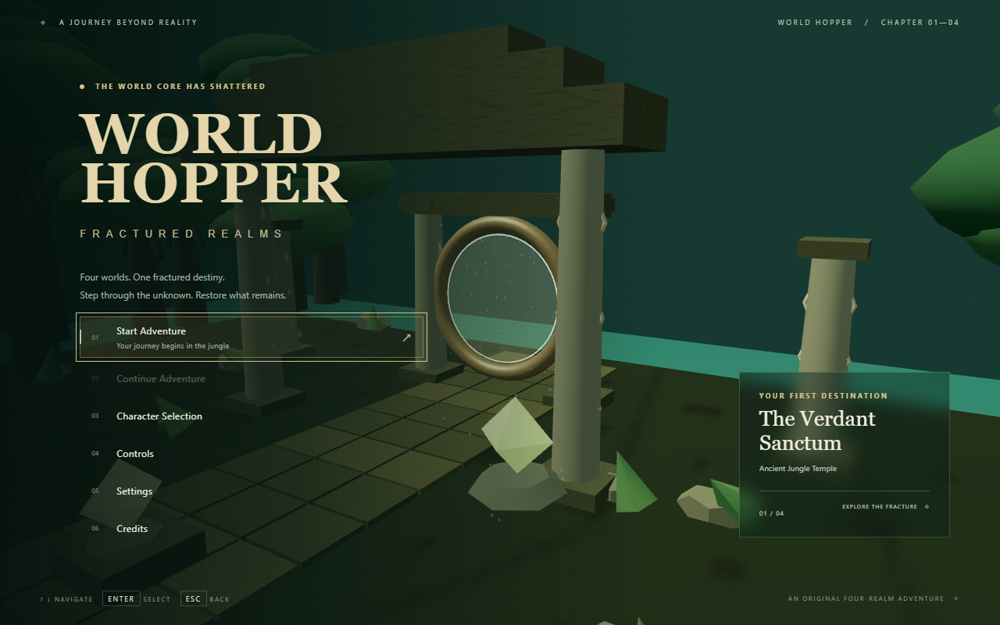
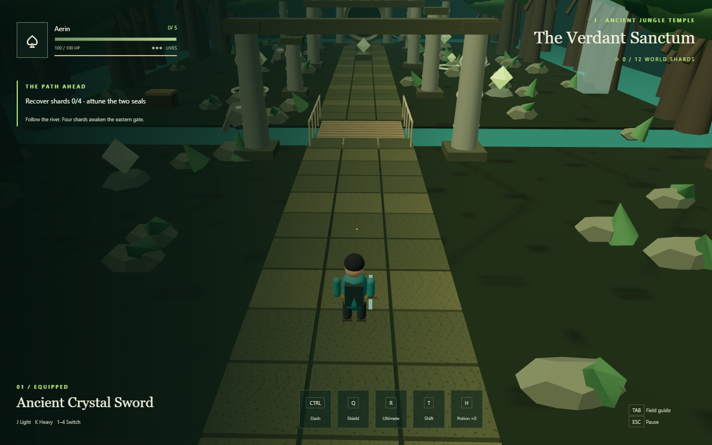
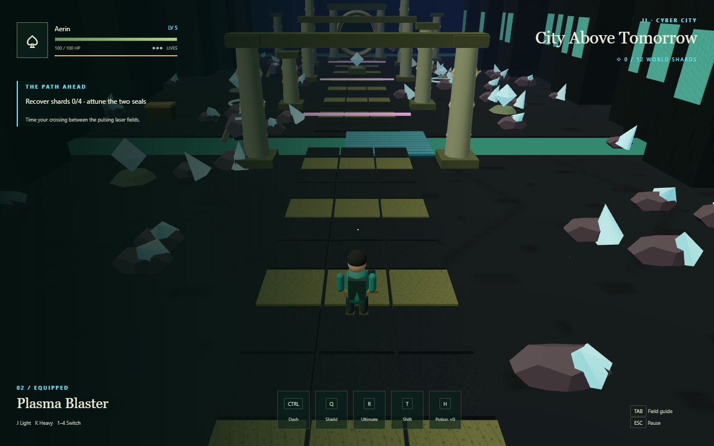
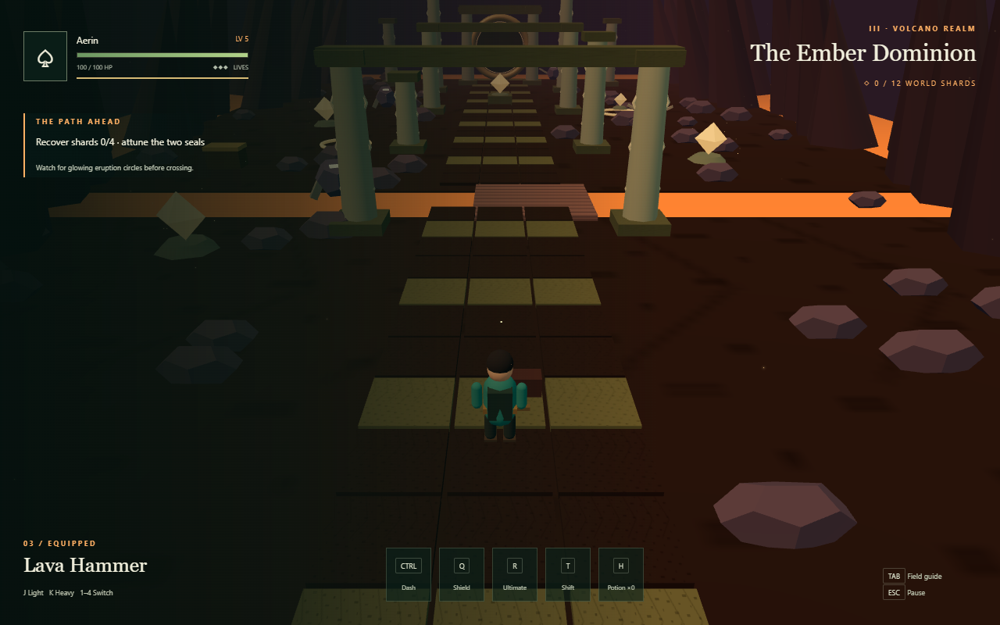
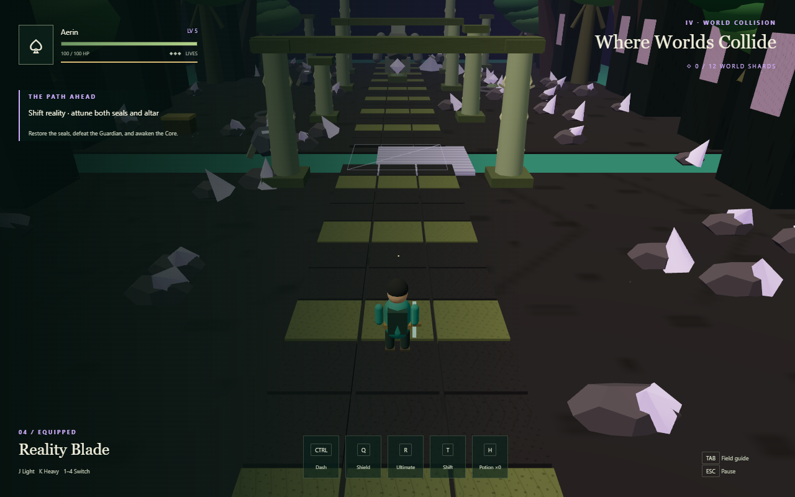

# World Hopper: Fractured Realms

<p align="center">
  
</p>

<p align="center">
  <strong>Travel across shattered dimensions. Recover the World Shards. Restore reality.</strong>
</p>

<p align="center">
  
  
  
  
</p>

## About the game

**World Hopper: Fractured Realms** is a browser-based third-person 3D action-adventure. Reality has shattered into four connected dimensions, and the World Guardian has seized the World Core. As a World Hopper, the player must explore each realm, recover twelve World Shards, solve ancient mechanisms, unlock powerful weapons and abilities, and defeat the Guardian before the worlds collapse into one.

The game is fully playable with a keyboard and runs directly in a modern desktop browser—no account, backend, mouse controls, or installation beyond the local development setup is required.

> **Achievement:** Awarded **3rd place** at the **Build a Multiplayer Game** event presented by the OpenAI Student Collective at Alliance University on 29 October 2026.

## Explore four fractured realms

| Realm | Experience | Weapon unlocked |
| --- | --- | --- |
| **Ancient Jungle Temple** | Cross a suspension bridge, explore overgrown ruins, recover shards, and awaken ancient seals. | Ancient Crystal Sword |
| **Cyber City** | Navigate a neon skyline, moving platforms, security systems, and energy hazards. | Plasma Blaster |
| **Volcano Realm** | Survive lava, eruptions, obsidian ruins, and fiery enemies. | Lava Hammer |
| **World Collision** | Shift reality through a world where jungle, technology, and volcanic energy have merged. | Reality Blade |

<p align="center">
  
  
</p>
<p align="center">
  
  
</p>

## Features

- Four connected, visually distinct 3D realms
- Twelve collectible World Shards and realm progression gates
- Keyboard-controlled movement, camera, jumping, sprinting, and dashing
- Light and heavy combat with four unlockable weapons
- Enemy encounters, hazards, checkpoints, lives, and respawning
- XP progression with double jump, shield, dash, and ultimate abilities
- Health, shield, speed, damage, and life-restoring consumables
- Keyboard-navigable inventory, pause menu, settings, and character selection
- Versioned local save system with **Continue Adventure** support
- Reality Shift puzzle mechanic in the final realm
- Three-stage World Guardian encounter and a complete victory sequence

## Controls

| Key | Action |
| --- | --- |
| `W` `A` `S` `D` | Move |
| Arrow keys | Rotate the camera and adjust its height |
| `Space` | Jump / double jump after unlocking it |
| `Left Shift` | Sprint |
| `Left Ctrl` | Dash |
| `J` / `K` | Light attack / heavy attack |
| `1`–`4` | Equip an unlocked weapon |
| `Q` | Energy Shield |
| `R` | Ultimate Reality Strike |
| `T` | Reality Shift in the final realm |
| `E` / `F` | Interact / collect |
| `H` | Use a health potion |
| `Tab` | Open or close inventory |
| `Esc` | Pause / back |
| `Enter` | Confirm a menu selection |

Menus and inventory are navigated using the arrow keys and `Enter`.

## Getting started

### Requirements

- [Node.js](https://nodejs.org/) 22.12 or later
- A modern desktop browser with WebGL and hardware acceleration enabled

### Run locally

```bash
git clone https://github.com/Harapriyadas26/world-hopper-fractured-realms.git
cd world-hopper-fractured-realms
npm ci
npm run dev
```

Open the local URL printed by Vite, normally [http://localhost:5173](http://localhost:5173).

### Build and test

```bash
npm test
npx playwright install chromium
npx playwright test
npm run build
```

The production build is generated in `dist/`.

## How to complete the adventure

In each of the first three realms, collect four floating World Shards, activate both glowing seals, awaken the central altar, and enter the newly opened portal. Explore away from the main path to discover treasure caches and consumables.

In World Collision, use Reality Shift with `T` to reveal the final route and activate its fractured mechanisms. Defeat the World Guardian, approach the restored World Core, and interact with it to complete the adventure.

## Technology

- **React 19** and **TypeScript** for the application and UI
- **Three.js**, **React Three Fiber**, and **Drei** for 3D rendering
- **Rapier** for physics and character collisions
- **Zustand** for game state and persistence
- **Vite** for development and production bundling
- **Vitest** and **Playwright** for game-logic and browser testing

## Project structure

```text
src/
├── game/
│   ├── Actors.tsx       # Player input, movement, combat, enemies and boss
│   ├── Crossing.tsx     # Realm bridges and shifting platforms
│   ├── Hopper.tsx       # Procedural player and weapon models
│   ├── World.tsx        # Realm environments and interactables
│   ├── config.ts        # Realm, weapon and progression configuration
│   ├── materials.ts     # Generated materials and textures
│   └── store.ts         # Game rules, inventory, progression and saves
├── main.tsx             # Scene composition and UI
└── style.css            # Interface styling
```

## Development status

The complete critical path—from character selection to restoring the World Core—is implemented and tested. This is an evolving prototype, with future work focused on richer character animation, more varied enemy behavior, expanded sound design, camera collision, environment detail, performance optimization, and encounter balancing.

Detailed implementation and verification notes are available in [IMPLEMENTATION_REPORT.md](IMPLEMENTATION_REPORT.md). Asset and license information is recorded in [ASSET_CREDITS.md](ASSET_CREDITS.md).

## Deployment

Create the production build with `npm run build`, then deploy the contents of `dist/` to any HTTPS static host. For Netlify, use `npm run build` as the build command and `dist` as the publish directory. For Vercel, select the Vite preset and use `dist` as the output directory.

## Recognition

World Hopper: Fractured Realms was created for the **Build a Multiplayer Game** event hosted at Alliance University, Bengaluru, and received **3rd place**. The project reflects rapid prototyping, creative game design, browser-based 3D development, and end-to-end implementation under a limited build timeframe.

---

<p align="center">
  Built with imagination, persistence, and a love for interactive worlds.
</p>
